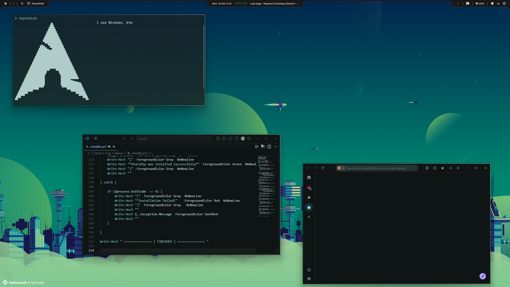
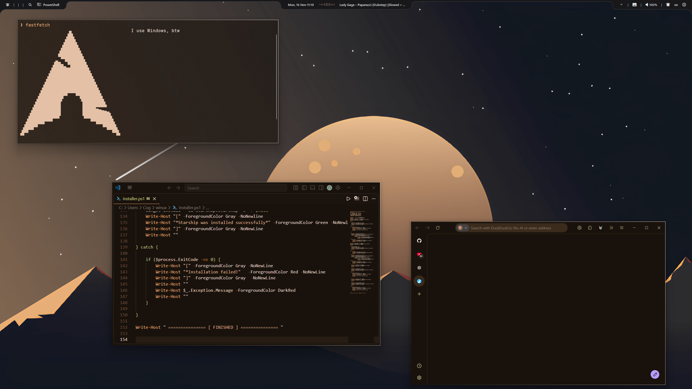
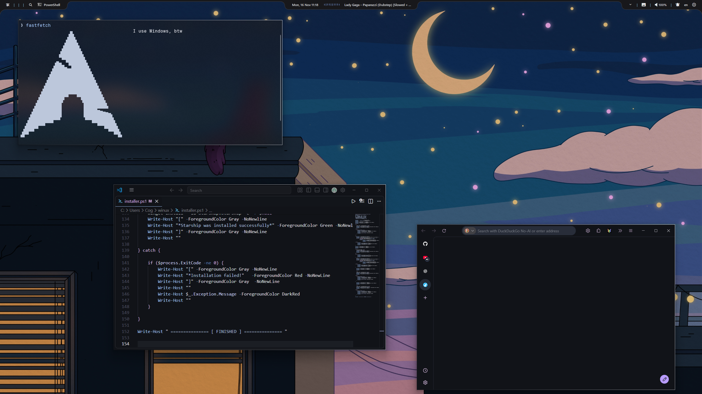

# Winux
Winux is a dynamic theming manager for Windows that uses Matugen
to generate color palettes from your wallpaper
and automatically applies them across Windows and supported applications.

Please note that the code may not be fully optimized
and could contain bugs, 
as I am still relatively new to programming 
and began learning recently. 
Contributions, suggestions, and improvements are welcome!

## Winux Preview

<p align="center">
  
  
  
</p>

## Possible Fix

I have released the **third version of the PowerShell installer**. Please try running it first.

If something doesn't work as expected, please follow the **manual installation instructions** instead.

### Run the installer

Copy and paste the following commands into PowerShell:

```powershell
$temp = "$env:TEMP\Winux"

New-Item -ItemType Directory -Force -Path $temp | Out-Null

irm https://raw.githubusercontent.com/cogypinguinbusiness-ctrl/Winux/main/installer.ps1 -OutFile "$temp\installer.ps1"
irm https://raw.githubusercontent.com/cogypinguinbusiness-ctrl/Winux/main/functions.ps1 -OutFile "$temp\functions.ps1"

& "$temp\installer.ps1"
```

# Manual Installation Guide

Follow these instructions to manually install Winux and all required dependencies.

## 1. Prerequisites

Before installing Winux, make sure you have the following components installed:

- Rust and Cargo
- Microsoft C++ Build Tools (MSVC)
- Windows SDK

These components are required to compile Matugen from source on Windows.

## 2. Installing Rust

Download and install Rust using the official Rustup installer:

https://rustup.rs/

Alternatively, install it through PowerShell:

```powershell
winget install --id Rustlang.Rustup -e
```

After installation, open a new PowerShell window and verify that Rust and Cargo are working:

```powershell
rustc --version
cargo --version
```

## 3. Installing Microsoft C++ Build Tools

Matugen requires a working compiler and linker to build from source.

1. Visit the official download page:

   https://visualstudio.microsoft.com/visual-cpp-build-tools/

2. Download and launch the installer.
3. Select **Desktop development with C++**.
4. Make sure the MSVC compiler and Windows SDK are selected.
5. Complete the installation.

Afterwards, restart your terminal.

## 4. Installing Matugen

Once Rust and the required build tools are installed, open PowerShell and execute:

```powershell
cargo install matugen
```

Cargo will download, compile and install Matugen.

To verify that the installation was successful, run:

```powershell
matugen --version
```

## 5. Installing Additional Dependencies

### Cava

Install Cava using WinGet:

```powershell
winget install --id karlstav.cava -e
```

### Starship

Install Starship using WinGet:

```powershell
winget install --id Starship.Starship -e

```
### Tacky Borders

Tacky Borders is needed for Winux to work. Winux will throw an error if it is not installed.

https://github.com/luke-you/tacky-borders

## 6. Optional Components

### Nerd Fonts

If you want to use Starship with icons and special symbols, install a Nerd Font.

https://github.com/ryanoasis/nerd-fonts

### btop

An optional terminal-based resource monitor.

```powershell
winget install --id aristocratos.btop4win -e
```

### Matugen VS Code Extension

If you use Visual Studio Code, you can install the Matugen Theme extension.

https://marketplace.visualstudio.com/items?itemName=aaronwold.matugen-theme

Follow its configuration guide to connect it with your Matugen templates.

## 7. Downloading and Launching Winux

1. Download the latest Winux release.
2. Locate the downloaded ZIP archive.
3. Right-click it and select **Extract All...**.
4. Choose your preferred extraction location.
5. Open the extracted Winux folder.
6. Double-click `Winux.exe` to launch the application.

> **Important:** Keep `Winux.exe` and the `_internal` folder in the same directory. Both are required for Winux to work correctly.

## 8. Troubleshooting

If you encounter problems during installation, make sure all required dependencies are installed correctly.

If Matugen cannot be found, try restarting PowerShell so that the updated PATH environment variables are loaded.

If you encounter a compilation error, make sure the MSVC compiler and linker were installed correctly.

If the problem persists, please report the error along with the relevant installation logs.


# Credits & Special Thanks

A huge thank you to the creators and maintainers of Matugen, Cava, Starship, the Matugen VS Code Extension, and Tacky Borders!

Without your amazing work and contributions to the open-source community, this project wouldn't have been possible.

Thank you for making tools that inspire others to create something of their own!
